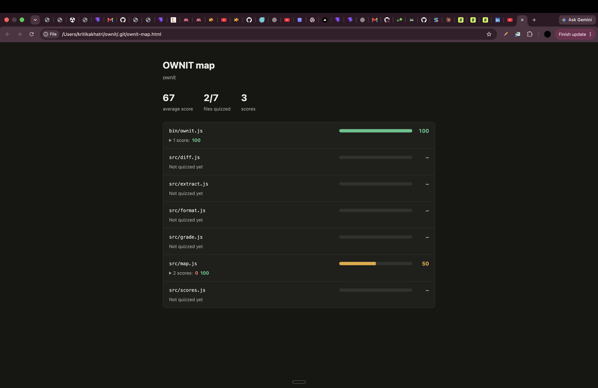

<div align="center">

# OWNIT

**Do you really understand your own code?**

[](https://www.npmjs.com/package/ownit-cli)
[](https://nodejs.org)
[](package.json)
[](LICENSE)

</div>

AI writes more and more of our code. It runs, it ships, and often nobody can explain it.

OWNIT picks a random function from your repo, asks you to explain it, and has Gemini grade your answer like a senior engineer would. Type it or say it out loud: you can't fake an explanation when you have to put it in your own words.

```
███████████████░░░░░ 75/100

✓ It calls fn again if it fails.
● The function retries `fn` up to `times` attempts.
● If `fn` fails on all `times` attempts, the error from the last attempt is re-thrown.

Follow-up: What determines how many times `fn` is called, and what happens if it fails on the final attempt?
```

## Features

- 🎯 **Random quizzes** on real functions from your own JavaScript and Python code
- 🧑‍💻 **Senior-engineer grading** that shows what you got right, missed and got wrong
- 💬 **Follow-up questions** that probe your weakest spot and move your score up or down
- 📖 **Learn mode** with a simple explanation when you get stuck
- 🗺️ **A map of your codebase** showing how well you know each file, in the terminal or as a webpage
- 🚦 **A diff check** that makes you explain your changes before you commit
- 📦 **Zero dependencies**: just Node.js and Git

## Quick start

You need Git, Node.js 18 or later and a free [Gemini API key](https://aistudio.google.com/apikey).

```sh
npm install -g ownit-cli
export GEMINI_API_KEY="your-key"
cd your-project
ownit
```

Add the `export` line to your shell profile (such as `~/.zshrc`) to keep it across sessions. Never commit your key.

## Commands

Run these inside any Git repository:

| Command | What it does |
|---|---|
| `ownit` | Quizzes you on a random function |
| `ownit map` | Shows each file with a bar and all its scores |
| `ownit map --html` | Creates a webpage of the map at `.git/ownit-map.html` |
| `ownit diff` | Asks you to explain your current Git changes |
| `ownit diff --min 70` | Same, but exits with code 1 if your score is below 70 |



## How it works

### Answering

Type or dictate your answer, across as many lines as you like. Press Enter on an empty line to finish. Pasted text is collected whole, even if it contains blank lines. Ctrl-D also finishes, and skips a follow-up without changing your score.

### Scoring

Your score starts at 100. Each wrong claim costs 15–30 points and each missing detail 3–10, because a false mental model is worse than an incomplete one. Your follow-up answer then adds or subtracts up to 15 points. Scores can vary slightly between runs.

### After each round

| Option | What it does |
|---|---|
| **Next** | Quiz another function, without repeats until you've seen them all |
| **Learn** | Show a simple explanation of this function |
| **Map** | Show how well you know each file |
| **Quit** | Exit |

### What gets quizzed

- **Included:** functions of 4 to 120 lines in `.js`, `.jsx`, `.mjs`, `.cjs` and `.py` files tracked by Git
- **Skipped:** `node_modules`, `dist`, test folders and test files
- **`ownit diff`:** staged and unstaged changes to tracked files. Run `git add` on a new file to include it. Diffs over 100,000 characters are cut off, and diff scores aren't saved.

## Privacy

Each quiz sends the function's code, its file path and your answers to Google's Gemini API. `ownit diff` sends your diff, so check it for secrets first.

Scores are saved locally in `.git/ownit-scores.json`, without your answers. They're never committed or pushed, so they stay on your machine.

## Configuration

| Environment variable | Purpose |
|---|---|
| `GEMINI_API_KEY` | Your API key (required for `ownit` and `ownit diff`) |
| `GEMINI_MODEL` | The model to use (default: `gemini-2.5-flash`) |
| `NO_COLOR` | Turns off colored output when set |

## Lessons learned

- **Pasted answers arrive in bursts, not keystrokes.** Stopping at the first blank line would cut a pasted answer short, so input ends on Enter on an empty line, with a short wait in case more text is coming.
- **Losing someone's effort is worse than making them wait.** Gemini sometimes fails with overload errors or timeouts, which would throw away the answer you just gave, so OWNIT tries up to four times before giving up.
- **Saving must never wipe your history.** Scores are written to a temporary file first, then swapped in, so a crash mid-save can't break the file.
- **Finding functions without a parser is hard.** Brackets and keywords inside strings, comments and regexes look like real code, so the scanner blanks those out before it looks for functions.

## Limitations

Functions are found with a built-in scanner rather than a full parser. Unusual syntax can give wrong line ranges or missed functions, and some forms such as JavaScript methods with quoted names aren't detected. TypeScript isn't supported yet.

## Why I built this

When I was new to web development, I wrote code that worked without really understanding why. It ran, so I moved on. OWNIT is the tool I wish I had then: one that asks me to explain my code out loud and shows me exactly where my understanding breaks.

What surprised me most was that explaining my own code out loud, the thing OWNIT tests, was also the best way to build it. Every time I couldn't say what a part should do, I knew I didn't understand it yet.

---

<div align="center">

Built by [Kritika Khatri](https://github.com/kritikhatri) · [MIT licensed](LICENSE)

</div>
